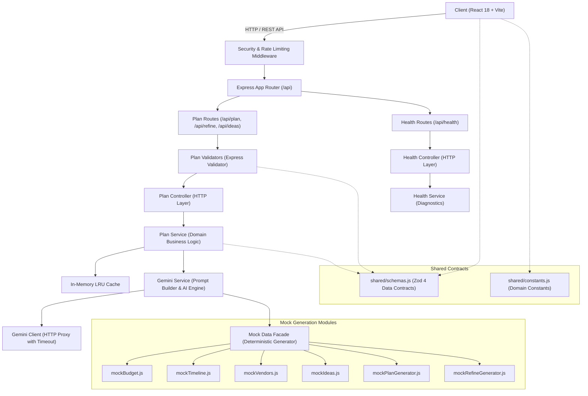

# System Architecture & Design Specification

Celebration & Event Planner is a full-stack, AI-powered event management application architected according to **Clean Architecture** and **Single Responsibility** principles. It delivers deterministic, hallucination-resistant celebration execution plans using Google Gemini GenAI with graceful mock fallbacks, strict prompt injection defenses, accessible UI components, and sub-second client rebalancing.

---

## 1. High-Level Architecture Overview



---

## 2. Architectural Layers

### A. Shared Contract Layer (`shared/`)

- **`schemas.js`**: Universal data contracts validated with Zod 4 (`EventProfileSchema`, `FullPlanSchema`, `BudgetPlanSchema`, `TimelineSchema`, `VendorChecklistSchema`, `IdeaSetSchema`, `RefineRequestSchema`).
- **`constants.js`**: Canonical domain constants (`CURRENCIES`, `EVENT_TYPES`, `TIMELINE_PHASES`, `DASHBOARD_TABS`, `VENDOR_STATUSES`, `BUDGET_CHART_PALETTE`, etc.). Eliminates magic strings and numbers across client and server.

### B. Backend Architecture (`server/`)

The backend is strictly decoupled into five distinct layers:

1. **Middleware Layer (`middleware/`)**:
   - `securityHeaders.js`: Content Security Policy (CSP), CORS, HSTS, frame protection, and cache control.
   - `rateLimiter.js`: Sliding window rate limiters (standard IP limiting + strict generative AI rate limiter).
   - `validate.js`: Express-validator error handler formatting schema violations.
   - `errorHandler.js`: Centralized error handling catching operational and programmatic exceptions (`AppError`, `NotFoundError`, `ValidationError`).
2. **Routing Layer (`routes/`)**:
   - `planRoutes.js`: Maps endpoints (`POST /api/plan`, `POST /api/refine`, `POST /api/ideas`, `POST /api/vendor-enquiry`) to validators and controllers.
   - `healthRoutes.js`: Maps `GET /api/health` to health controller.
3. **Controller Layer (`controllers/`)**:
   - `planController.js`: Extracts request parameters, handles HTTP status codes, and delegates to domain services.
   - `healthController.js`: Renders diagnostic connectivity and uptime payloads.
4. **Service Layer (`services/`)**:
   - `planService.js`: Business logic for cache lookups, prompt sanitization, Gemini orchestration, and schema validation.
   - `geminiService.js`: Retries, timeout handling, and JSON schema extraction from Gemini LLM output.
   - `geminiClient.js`: Low-level HTTPS transport client with Bearer token authentication and payload boundaries.
   - `healthService.js`: System diagnostics, environment verification, and uptime statistics.
5. **Mock / Provider Layer (`services/mock/`)**:
   - Modular mock generators (`mockBudget.js`, `mockTimeline.js`, `mockVendors.js`, `mockIdeas.js`, `mockPlanGenerator.js`, `mockRefineGenerator.js`) providing deterministic event plans when external LLM APIs are offline or unreachable.

### C. Frontend Architecture (`client/`)

The frontend is structured into modular presentation and logic tiers:

1. **Views & Routing (`App.jsx`)**: High-level state orchestrator managing transitions between landing page, 4-step wizard, and interactive dashboard.
2. **Dashboard Modules (`components/dashboard/`)**:
   - `BudgetTab`: Auto-rebalancing financial calculator with overflow alerts and per-guest metrics.
   - `TimelineTab`: Milestone schedule with backward compression from celebration date and .ics calendar exports.
   - `VendorsTab`: Vendor checklist with budget variances, red flag warnings, and automated enquiry copy.
   - `IdeasTab`: Bespoke creative deck with 1-click timeline integration.
   - `PrintDossierView`: Print-friendly `@media print` executive dossier with zero ink waste.
3. **Conversational AI Refinement (`components/refine/`)**:
   - `RefineDrawer`: Slide-over conversational assistant with before/after diff summary and inline undo.
4. **State & Logic Hooks (`hooks/` & `utils/`)**:
   - `useEventPlan.js`: Central plan state hook handling debounced autosave, history undo stack, and API calls.
   - `planMutators.js`: Pure functional state mutators keeping hook sizes minimal.
   - `apiService.js`: Centralized HTTP service encapsulating all API routes.
   - `budgetRebalancer.js`: Mathematical budget rebalancing engine guaranteeing exact 100% allocations.
   - `timelineEngine.js`: Timezone-safe UTC date calculation and lead-time milestone compression.

---

## 3. End-to-End Data Flow

### Event Generation Flow

```
1. User completes EventWizard (Steps 1-4) or selects 1-Click Judge Profile.
2. Wizard executes client-side Zod validation (`EventProfileSchema`).
3. Client posts profile to `POST /api/plan` via `apiService.js`.
4. Security middleware checks rate limits and payload limits (max 256KB).
5. Router passes request to `validatePlanRequest` middleware.
6. `PlanController` forwards profile to `PlanService.generatePlan`.
7. `PlanService` checks in-memory LRU cache (`CacheService`).
   - On cache hit: Returns cached FullPlan immediately (< 10ms).
   - On cache miss: Dispatches prompt to `GeminiService`.
8. `GeminiService` executes Gemini 1.5 Flash query with 10s timeout.
   - On LLM failure/timeout: Falls back gracefully to `MockDataService`.
9. `PlanService` validates generated plan against `FullPlanSchema` and populates cache.
10. `PlanController` returns HTTP 200 JSON to client.
11. Client updates `currentPlan`, transitions to dashboard, and autosaves to localStorage.
```

### Natural Language Refinement Flow

```
1. User types instruction in `RefineDrawer` (e.g. "make it cheaper").
2. Client posts `{ currentPlan, instruction, targetSection }` to `POST /api/refine`.
3. Server checks guardrails against prompt injection and off-topic requests.
4. LLM applies surgical updates across specified sections.
5. Server returns updated plan.
6. Client computes before/after diff via `planDiffEngine.js`.
7. Client stores previous plan in `planHistory` for 1-click undo.
8. Interactive UI updates reactively with change badges.
```

---

## 4. Error Handling & Resilience Strategy

- **Backend**: All errors inherit from `AppError` with clear HTTP status codes (`400 Bad Request`, `404 Not Found`, `429 Too Many Requests`, `500 Internal Error`). Unhandled exceptions are logged through `serverLogger` and rendered via centralized `errorHandler` middleware.
- **Frontend**: API responses pass through `networkErrors.js` to normalize network disconnections, timeout aborts, and backend validation errors into actionable, accessible messages displayed via `ErrorAlert`.
- **Offline Mode**: Automatic online/offline detection keeps users informed when connectivity drops, preventing data loss.

---

## 5. Security & Prompt Injection Defense

1. **Strict Input Sanitization**: Special notes and event prompts are stripped of control characters and capped at length limits.
2. **System Prompt Guardrails**: Gemini system prompts explicitly enforce event planning focus, refusing off-topic or malicious prompt injections with structured `Refusal Notice` responses.
3. **Secrets Isolation**: API keys are securely read from server environment variables; server loggers automatically redact any API keys or authorization headers.
4. **Header Hardening**: Strict CSP directives, HSTS, X-Content-Type-Options: nosniff, and X-Frame-Options: DENY.
